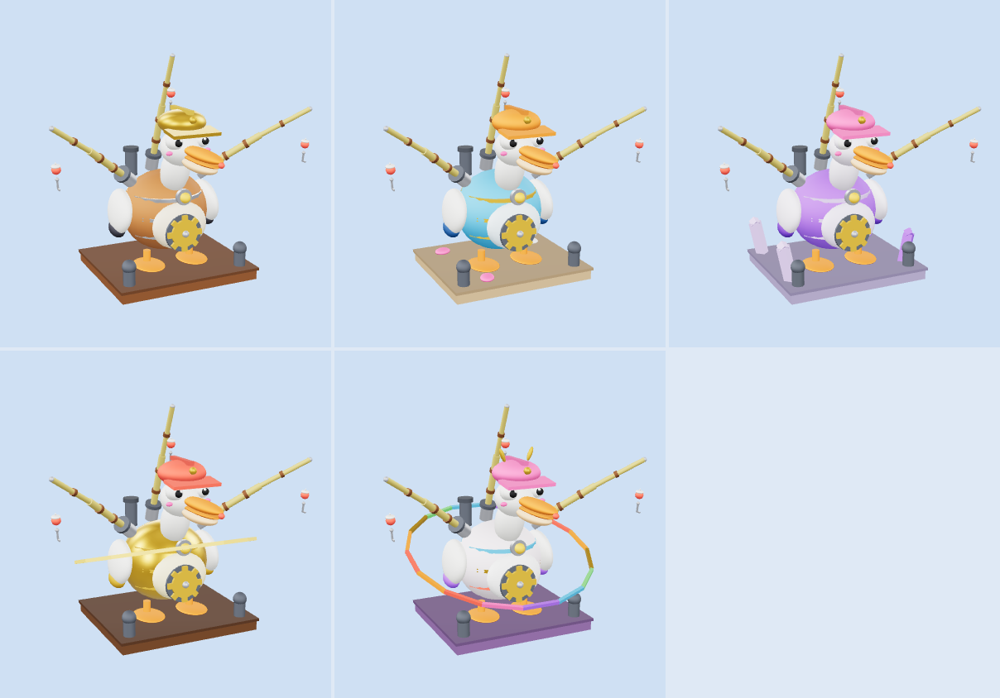
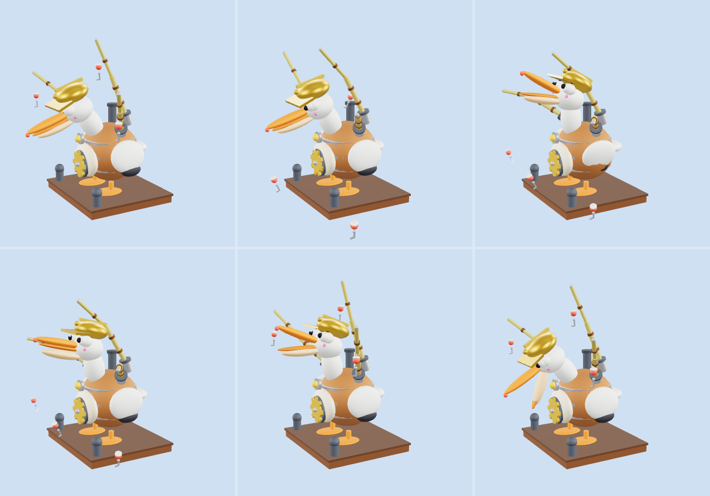

# Máy câu tự động (AutoFisher)

Model, animation và hiệu ứng cho máy câu tự động trong GDD *Hồ Không Cho Câu*, 5 lớp theo độ hiếm. Máy là vật phẩm nên theo mục 1.1 của [STYLE_GUIDE.md](../STYLE_GUIDE.md): nó mang **linh hồn thú vật**, cụ thể là một **con bồ nông làm bằng máy móc**. Cái túi dưới mỏ chính là chỗ chứa cá: túi phồng dần theo số cá câu được, nhìn là biết máy còn trống hay đã đầy.

> Muốn thêm model cùng loại: xem [PRODUCTION.md](PRODUCTION.md) (khung sản xuất).



Ảnh trên: Thường, Hiếm, Sử thi (hàng trên), Huyền thoại, Thần thoại (hàng dưới). Ảnh dưới là sáu thời điểm của máy Thường (gật gù, đang chạy, ngẩng lên nuốt cá, nuốt xong, đầy túi, nhả cá):



Ảnh render từ GLB, nên không có dây câu (dây là `Beam` do script tạo), ổ khóa và các mức túi phồng (ẩn đến khi game đặt `Slots` và `Fill`).

## Hình dáng

- **Thân:** thùng máy tròn mập, có đai kim loại, bánh răng đồng lộ ở bụng (quay khi làm việc), đèn trạng thái ở ngực, ống khói nhả hơi ở sau lưng. Đứng bằng hai chân chèo cam trên bệ gỗ có hai cọc neo bờ hồ. Thân và mũ cao khoảng 5,2 stud, cần nhô lên tới khoảng 6,5 stud, bệ rộng 4,2 stud.
- **Đầu bồ nông:** cổ trắng dài, mắt to có đốm sáng, má hồng, mỏ cam rất dài kèm túi da dưới mỏ, **đội mũ bảo hộ** có đèn nhỏ (nét hài). Mắt có mí để ngủ gật, nháy hay nhắm khi hắt xì.
- **Hai cánh và đuôi:** cánh trắng đầu cánh sẫm vỗ khi vui, đuôi quẫy khi chạy.
- **Ba cần tre cắm sẵn** (cần giữa trên lưng, hai cần ở hai vai chĩa ra mặt nước), mỗi cần có phao đỏ trắng và móc, tự quăng và kéo. Sau này game thay bằng model `FishingRod`.

### Năm lớp màu theo độ hiếm

| File | Bậc (`Rarity`) | Thân và màu | Phụ kiện thêm |
| --- | --- | --- | --- |
| `AutoFisher_Common` | Thường | Thùng gỗ, đai bạc, mũ vàng, bệ gỗ tối | Không |
| `AutoFisher_Rare` | Hiếm | Thân xanh biển, đai đồng thau, mũ cam, bệ gỗ trôi | Ba vỏ sò hồng và trắng trên bệ |
| `AutoFisher_Epic` | Sử thi | Thân tím, đai tím nhạt, mũ hồng, bệ đá tím | Tinh thể mọc ở bốn góc bệ |
| `AutoFisher_Legendary` | Huyền thoại | Thân vàng, đai vàng đậm, mũ đỏ | Vòng hào quang vàng xoay quanh thân |
| `AutoFisher_Mythic` | Thần thoại | Thân ngọc trai, ba đai đỏ vàng xanh, mũ hồng, bệ tím | Hai sừng vàng trên mũ, vòng hào quang cầu vồng xoay quanh thân, dây câu cầu vồng |

Mỗi file gồm `.rbxmx` (đưa vào Studio) và `.glb` (chỉ để xem). Số lượng Part: Thường 109, Hiếm 112, Sử thi 117, Huyền thoại 126, Thần thoại 128.

## Rig

```
HumanoidRootPart
└─ Body (thân)
   ├─ Gear (bánh răng)
   ├─ WingL, WingR (cánh)
   ├─ Tail (đuôi)
   ├─ Neck ─ Head ─┬─ Jaw (mỏ dưới) ─ Pouch (túi cá)
   │               └─ LidL, LidR (mí mắt)
   └─ Rod1_A ─ Rod1_B ─ Rod1_Hook        (cần giữa)
      Rod2_A ─ Rod2_B ─ Rod2_Hook        (cần vai trái)
      Rod3_A ─ Rod3_B ─ Rod3_Hook        (cần vai phải)
```

Mỗi khớp là một `Motor6D`, tên khớp trùng tên part con. Các part trang trí được hàn bằng `Weld` vào part xương tương ứng. Mỗi cần có hai đoạn uốn cong (`_A`, `_B`) và móc (`_Hook`).

Các part chỉ hiện khi game yêu cầu (ẩn sẵn):
- `LockCap<n>`, `LockBody<n>`: nắp đậy và ổ khóa ở ổ cắm số n.
- `PouchBulge1` đến `PouchBulge3`: ba mức túi phồng.
- `Halo` và `HaloRing<n>` (Huyền thoại, Thần thoại): vòng hào quang, xoay do script.

## Animation

Game đổi attribute `Anim`. Máy đang chạy thì để `Work`, có cá thì phát `Catch` rồi quay lại `Work`, túi đầy thì để `Full`, người chơi lấy cá thì phát `Collect`.

| Tên | Lặp | Thời lượng | Mô tả |
| --- | --- | --- | --- |
| `Idle` | có | 2,4 giây/vòng | Nghỉ: đầu gật gù, mắt lim dim, thân và đuôi động nhẹ, cần buông, đèn vàng |
| `Work` | có | 2,4 giây/vòng | Đang chạy: thân rung, bánh răng quay một vòng mỗi chu kỳ, đầu cúi nhìn nước, cánh và đuôi động, đèn xanh. **Ba cần tự quăng, kéo** theo chu kỳ 2,4 giây (lấy đà, quất ra, rơi xuống nước, kéo về), cần sau chậm hơn cần trước 0,8 giây nên không đồng loạt |
| `Catch` | không | 1,2 giây | Có cá cắn: đầu ngẩng lên, há mỏ (0,25 giây), nuốt cái ực và túi phình ra (0,5), cánh vỗ, cả máy nhún lên, rồi cúi nhìn nước lại |
| `Full` | có | 2,4 giây/vòng | Túi đầy: đầu ngẩng, mỏ há ra chờ người lấy, hai cánh vẫy luân phiên, mắt tròn, đèn đỏ chớp |
| `Collect` | không | 1,6 giây | Lấy cá: ngả đầu ra sau, mắt nhắm (0,35), há mỏ thật to nhả cá (0,6), ngậm lại, hắt xì (1,4) |

Thời lượng theo mục 4.5 của `STYLE_GUIDE.md`. `Catch` và `Collect` giữ khung cuối cho tới khi đổi `Anim`. Muốn phát lại cùng một animation không lặp thì phải đổi `Anim` sang tên khác trước.

Animation được phát bởi script `MachineAnimator`, đó là bản `GooseAnimator` của PoliceGoose dùng lại nguyên văn (ghi `Motor6D.Transform` trực tiếp, không cần upload animation).

## Hiệu ứng và attribute (`MachineEffects`)

Một script client cho cả 5 lớp, đọc các attribute:

| Attribute | Ý nghĩa | Mặc định |
| --- | --- | --- |
| `Anim` | Trạng thái animation (bảng trên) | `Idle` |
| `Rarity` | Bậc độ hiếm (đặt sẵn trong model) | theo file |
| `Slots` | Số ổ cần đang mở, từ 1 đến 3. Ổ chưa mở hiện nắp đậy và ổ khóa, cần và dây của ổ đó ẩn đi | 3 (khi thiếu) |
| `Fill` | Số cá trong túi, từ 0 đến 3. Túi phồng theo mức | 0 (khi thiếu) |

Hiệu ứng:
- **Viền sáng** (`Highlight`) theo màu độ hiếm, nhấp nháy khi `Idle` và `Full` (Thần thoại đổi màu cầu vồng).
- **Đèn trạng thái** ở ngực: vàng (`Idle`), xanh lá (`Work`), trắng xanh (`Catch`), đỏ chớp (`Full`), xanh biển (`Collect`).
- **Hơi nước** từ ống khói: thưa khi `Idle`, đều khi `Work`, một cụm lớn khi hắt xì.
- **Dây câu:** ba `Beam` mảnh từ đầu mỗi cần xuống móc, tự co giãn.
- **Hạt lấp lánh** quanh thân khi `Idle` và `Work`, tốc độ theo độ hiếm. Khi `Catch` (0,5 giây) có chớp sáng và một đợt hạt ở miệng, khi `Collect` (0,6 giây) đợt hạt gấp đôi. Số hạt: 15 (Thường), 30, 50, 80, 110 (Thần thoại).
- **Hào quang xoay** (Huyền thoại, Thần thoại): vòng khối Neon nghiêng xoay quanh thân.

Chỉ dùng texture hạt có sẵn của Roblox, không cần upload.

## Cài vào Roblox Studio

1. Kéo thả file `.rbxmx` vào cửa sổ Studio, hoặc chuột phải vào `ServerStorage` rồi chọn **Insert from File...**
2. Để thử nhanh, đặt model vào `Workspace` và bấm **Play** (F5). Trong Explorer (góc nhìn client), chọn model rồi đổi attribute `Anim` sang `Idle`, `Work`, `Catch`, `Full` hoặc `Collect`. Thử thêm attribute số `Slots` (1 đến 3) và `Fill` (0 đến 3).
3. Khi chạy game thật, giữ bản mẫu trong `ServerStorage` và clone ra `Workspace`, đừng để bản mẫu trong `ReplicatedStorage` vì script client sẽ chạy cả trên bản mẫu đó.

## Thay cần tre bằng FishingRod về sau

Ba cần tre là phần của máy (các part `Rod1_*` đến `Rod3_*`) để máy chạy được ngay. Khi game dùng `FishingRod`, ẩn các part này và gắn model cần vào đúng ổ: cần giữa tại khoảng (0, 3,05, 1,0) nghiêng 20 độ về phía trước, hai cần vai tại khoảng (±1,15, 2,95, 0) nghiêng 55 độ ra ngoài và về phía trước. Giá trị chính xác nằm trong bảng `SLOTS` của `build_machine.py`. Hai `Socket<n>` và `SocketRim<n>` (ống cắm kim loại) vẫn ở lại.

## Xem nhanh bằng file GLB

Mỗi `AutoFisher_<Bậc>.glb` chứa model và 5 animation (mỗi animation là một clip). Mở bằng https://gltf-viewer.donmccurdy.com, **3D Viewer** của Windows hoặc Blender. File GLB chỉ để xem: không có hiệu ứng, không có dây câu, không có ổ khóa và các mức túi phồng, hào quang đứng yên, vật liệu Neon hiện như màu thường.

## Chỉnh sửa

- Sửa `build_machine.py` rồi chạy `python build_machine.py` để tạo lại cả 5 file `.rbxmx` và `.glb`. Script chỉ dùng thư viện chuẩn của Python, dùng lại bộ ghi `.rbxmx` của `PoliceGoose` và các hàm của `Egg` (`crystal`, `ring_around`, màu).
  - Khung dùng chung: `pelican_parts`, `rod_parts`, `JOINTS`, bảng `ANIMATIONS`.
  - Mỗi lớp: bảng `RARITIES` (màu thân, bụng, đai, đầu, mũ, bệ và hàm phụ kiện).
  - Chu kỳ quăng và kéo của cần: bảng `CYCLE` (độ uốn hai đoạn cần, tầm xa và độ cao của móc, mỗi 0,4 giây). Vị trí móc được tính tự động (`rod_pose`) từ độ uốn nên sửa độ uốn thì móc vẫn ra đúng chỗ.
  - Vị trí và độ nghiêng các ổ cắm: bảng `SLOTS`.
- Muốn thêm lớp mới: thêm một hàm phụ kiện và một dòng vào `RARITIES`.

## Lưu ý

- Chưa có âm thanh. Làm sau theo [SOUND_GUIDE.md](../SOUND_GUIDE.md).
- Chỉ làm model, animation, phụ kiện và hiệu ứng. Logic tự câu (bao lâu có một con cá, cá gì, tự động thu), thay cần, mở ổ nằm ở phía game, không nằm trong repo này.
- Máy khoảng 110 đến 130 Part, cộng hiệu ứng. Khi nhiều máy cùng hiện trên mobile, nên chỉ bật animation và hiệu ứng cho máy ở gần.
- File được sinh bằng script và đã kiểm tra hình dáng, tư thế bằng ảnh render GLB (`preview.png`, `preview_action.png`), nhưng **chưa mở thử trong Roblox Studio**, kể cả script hiệu ứng, ổ khóa, túi phồng, dây `Beam` và hào quang xoay.
