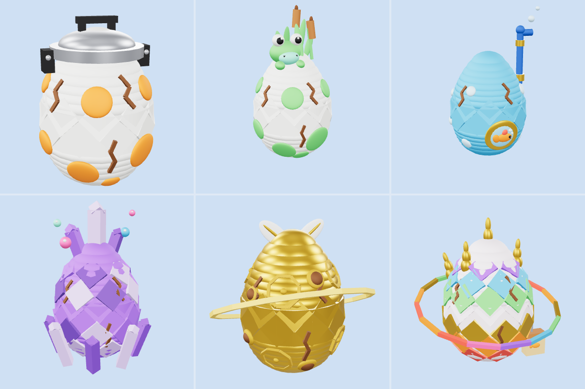
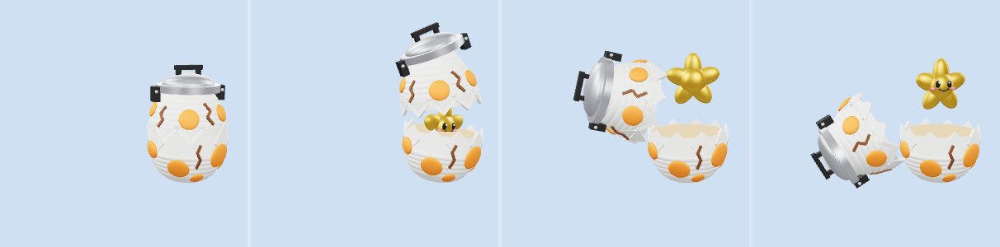

# Trứng (Egg)

Model, animation và hiệu ứng cho 6 quả trứng pet trong GDD *Hồ Không Cho Câu*, mỗi bậc độ hiếm một quả (riêng bậc Thường có hai quả). Cả 6 dùng chung một khung (vỏ vỡ đôi, ngôi sao bên trong, rig, animation, script hiệu ứng) và chỉ khác màu, họa tiết, phụ kiện.

> Muốn thêm model cùng loại: xem [PRODUCTION.md](PRODUCTION.md) (khung sản xuất).



Ảnh trên: Khởi Đầu, Lau Sậy, Bong Bóng (hàng trên), Tinh Thể, Vàng Mồi, Rồng (hàng dưới). Ảnh dưới là bốn thời điểm (0, 2,4, 3,1 và 4,9 giây) của animation `Hatch`:



Ảnh render từ GLB, nên vết nứt hiện sẵn dù trong Roblox chúng ẩn đến khi ấp.

## Danh sách trứng

| File | Bậc (`Rarity`) | Hình dáng | Nét hài | Pet nở ra (xem `Pet/`) |
| --- | --- | --- | --- | --- |
| `Egg_Starter` | Thường | Trứng kem đốm cam, đội nắp nồi cơm điện bằng kim loại (quai đen, hai chốt hai bên) | Cái nắp nồi lạch cạch khi ấp | Mèo Đội Nồi (quả cố định cho người mới) |
| `Egg_Reed` | Thường | Trứng kem có mảng rêu xanh, bụi cỏ lau và hai bông cỏ nến trên đỉnh | Con ếch ngồi lên đòi ở chung | Chó Bánh Mì |
| `Egg_Bubble` | Hiếm | Trứng xanh biển, ô cửa tròn viền vàng có cá vàng bơi, bong bóng trên vỏ, ống thở xanh cắm bên hông | Trứng đeo ống thở, ống thở nhả bong bóng | Vịt Cơ Bắp |
| `Egg_Crystal` | Sử thi | Trứng tím ghép từ mảnh tinh thể ba sắc, vòng tinh thể mọc quanh chân, cụm tinh thể trên đỉnh | Bong bóng nhiều màu bay lơ lửng quanh đầu | Mèo Ảo Thuật Gia |
| `Egg_Gold` | Huyền thoại | Trứng vàng có các vòng xoắn vàng đậm, hai lông vũ trắng trên đỉnh, vòng hào quang vàng xoay quanh | Vài lỗ bị ngỗng bảo vệ mổ (nó thèm) | Chó K9 Cảnh Sát |
| `Egg_Dragon` | Thần thoại | Trứng ngọc trai phủ vảy bảy sắc cầu vồng, gai vàng trên đầu và hai bên, vòng hào quang cầu vồng xoay quanh | Túi giấy hình con cá ("tiền ăn trưa" của rồng) treo bên hông và lắc lư | Rồng Con Văn Phòng |

Mỗi file gồm `.rbxmx` (đưa vào Studio) và `.glb` (chỉ để xem). Số lượng Part: Starter 90, Reed 103, Bubble 95, Crystal 128, Gold 183, Dragon 158. Vàng Mồi nhiều Part nhất (rương Thần thoại có 134), nên khi nhiều trứng cùng hiện trên mobile hãy chỉ bật hiệu ứng cho trứng ở gần.

## Thiết kế chung

- **Phong cách:** theo [STYLE_GUIDE.md](../STYLE_GUIDE.md), dựng từ Part có sẵn của Roblox (cầu dẹt, trụ, khối). Không cần upload mesh hay texture.
- **Vỏ vỡ làm đôi theo đường răng cưa:** giữa hai nửa là các răng cưa xen kẽ (nửa dưới nhô lên, nửa trên thòng xuống), nên lúc đóng thấy một vết nứt gãy khúc quanh thân, lúc tách ra cả hai mép đều lởm chởm như trứng vỡ thật.
- **Ngôi sao mặt cười:** pet nhảy ra là một ngôi sao vàng 5 cánh bầu bĩnh, có mắt, đốm sáng, má hồng và miệng cười. Nó nằm ẩn trong nửa vỏ dưới cho tới khi nở. Cả 6 quả dùng chung ngôi sao này.
- **Vết nứt:** 3 mức, ẩn sẵn và hiện dần theo tiến độ ấp.
- **Kích thước:** thân cao 3 stud, rộng khoảng 2,3 stud. Phụ kiện đỉnh làm cao thêm 0,3 đến 1,4 stud.
- **Màu:** mỗi quả lấy màu chủ đạo từ bảng màu độ hiếm trong `STYLE_GUIDE.md` (trắng, xanh biển, tím, vàng, cầu vồng), nét nhấn cam, đen, bạc.

### Rig

```
HumanoidRootPart
└─ Base (nửa vỏ dưới)
   ├─ Top (nửa vỏ trên) ─ Topper (phụ kiện đỉnh: nắp nồi, cụm cỏ, ống thở, cụm tinh thể, lông vũ, gai)
   └─ Star (ngôi sao, ẩn trong Base)
```

Mỗi khớp là một `Motor6D`, tên khớp trùng tên part con. Các part trang trí được hàn bằng `Weld` vào part xương tương ứng. Hai vật chuyển động riêng không nằm trong rig và do script `EggEffects` điều khiển: `Halo` (vòng hào quang của Vàng Mồi và Rồng) và `BagHinge` (túi giấy của Rồng).

## Animation

Mỗi model có 3 trạng thái. Game đổi attribute `Anim`.

| Tên | Lặp | Mô tả |
| --- | --- | --- |
| `Idle` | có (2,4 giây/vòng) | Nằm yên, lắc nhẹ chờ |
| `Incubate` | có (2,4 giây/vòng) | Đang ấp: rung chậm, phụ kiện đỉnh lạch cạch, vỏ phồng nhẹ, tỏa hơi ấm |
| `Hatch` | không (5,0 giây) | Nở: trứng lắc với biên độ tăng dần và vết nứt hiện dần, nén xuống rồi vỡ làm đôi. Nửa vỏ trên bị đẩy lên và lệch sang một bên, đổ xuống nằm cạnh nửa dưới (nảy nhẹ một lần). Ngôi sao chui ra từ từ, xoay rồi lơ lửng phía trên. Giữ tư thế cuối cho tới khi đổi `Anim` |

**Thời lượng tiêu chuẩn** (xem [STYLE_GUIDE.md](../STYLE_GUIDE.md) mục 4.5): `Idle` và `Incubate` lặp 2,4 giây, `Hatch` 5,0 giây. Mốc của `Hatch` (giây): 0,4 / 0,9 / 1,4 hiện vết nứt mức 1 / 2 / 3, 2,0 nén xuống, 2,4 vỡ làm đôi, 3,4 nửa vỏ trên chạm đất, 3,8 ngôi sao ổn định, 5,0 kết thúc. Script hiệu ứng dùng đúng các mốc này (`CRACK_TIMES`, `POP_TIME`, `LAND_TIME`, `SETTLE_TIME`), nên đổi thời lượng thì phải sửa cả hai nơi.

Animation được phát bởi script `EggAnimator`, đó là bản `GooseAnimator` của PoliceGoose dùng lại nguyên văn (ghi `Motor6D.Transform` trực tiếp, không cần upload animation).

## Hiệu ứng (`EggEffects`)

Một script client cho cả 6 quả, theo attribute `Rarity`, `Anim` và `Progress`:

- **Viền sáng** (`Highlight`) theo màu độ hiếm, nhấp nháy khi `Idle` và `Incubate` (Thần thoại đổi màu cầu vồng).
- **Incubate:** ánh sáng ấm cam thở nhịp, hơi nước bốc ra từ đỉnh. Vết nứt hiện dần theo `Progress` (số từ 0 đến 1, game đặt, thiếu thì coi là 0): mức 1 ở 0,3, mức 2 ở 0,6, mức 3 ở 0,9.
- **Hatch:** vết nứt hiện dần khi trứng lắc, lúc vỡ có chớp sáng và hạt lấp lánh, ngôi sao để lại vệt sao vàng khi bay, nửa vỏ chạm đất thì bụi nhỏ bốc lên.
- **Độ hiếm càng cao càng rực:** số hạt lúc vỡ tăng (20 cho Thường, 40 Hiếm, 70 Sử thi, 110 Huyền thoại, 150 Thần thoại), hạt lấp lánh khi chờ từ bậc Hiếm, và **tia sáng** bắn lên lúc vỡ ở bậc Huyền thoại và Thần thoại.
- **Vòng hào quang** (Vàng Mồi, Rồng): vòng khối Neon nghiêng, xoay quanh trục đứng.
- **Túi giấy** (Rồng): lắc lư trên sợi dây.

Chỉ dùng texture hạt có sẵn của Roblox, không cần upload.

## Cài vào Roblox Studio

1. Kéo thả file `.rbxmx` vào cửa sổ Studio, hoặc chuột phải vào `ServerStorage` rồi chọn **Insert from File...**
2. Để thử nhanh, đặt model vào `Workspace` và bấm **Play** (F5). Trong Explorer (góc nhìn client), chọn model rồi đổi attribute `Anim` sang `Idle`, `Incubate` hoặc `Hatch`. Thử vết nứt bằng cách thêm attribute số `Progress` (0 đến 1).
3. Khi chạy game thật, giữ bản mẫu trong `ServerStorage` và clone ra `Workspace`, đừng để bản mẫu trong `ReplicatedStorage` vì script client sẽ chạy cả trên bản mẫu đó.
4. Muốn phát lại `Hatch`, phải đổi `Anim` sang tên khác trước rồi mới đặt lại.

## Xem nhanh bằng file GLB

Mỗi `Egg_<Tên>.glb` chứa model và 3 animation (mỗi animation là một clip). Mở bằng https://gltf-viewer.donmccurdy.com, **3D Viewer** của Windows hoặc Blender. File GLB chỉ để xem: không có hiệu ứng, không ẩn vết nứt, vòng hào quang và túi giấy đứng yên, vật liệu Neon hiện như màu thường. Muốn dùng trong Roblox thì dùng `.rbxmx`.

## Chỉnh sửa

- Sửa `build_egg.py` rồi chạy `python build_egg.py` để tạo lại cả 6 file `.rbxmx` và `.glb`. Script chỉ dùng thư viện chuẩn của Python.
  - Khung dùng chung: `egg_parts`, `tooth_parts`, `star_parts`, `ANIMATIONS`.
  - Mỗi quả: bảng `EGGS` (màu vỏ, màu ruột, hàm trang trí) và các hàm `starter_decor`, `reed_decor`, `bubble_decor`, `crystal_decor`, `gold_decor`, `dragon_decor`.
  - Hàm họa tiết dùng lại được: `dots` (đốm, bong bóng, rêu), `swirl` (vòng xoắn), `plate_rows` (vảy, mảnh tinh thể), `crystal`, `spike`, `ring_around` (hào quang).
- Vỏ được ghép từ các lát cầu dẹt chồng nhau và hai dải trụ quanh mặt cắt (Roblox không có Part dạng nửa quả trứng), nên có thể thấy vân rất nhẹ khi nhìn sát.
- Muốn thêm quả mới: thêm một hàm trang trí và một dòng vào `EGGS`. Phụ kiện đỉnh phải có part tên `Topper` (xương) và các part còn lại hàn vào `Topper`.

## Lưu ý

- Chưa có âm thanh. Làm sau theo [SOUND_GUIDE.md](../SOUND_GUIDE.md).
- Chỉ làm model, animation, phụ kiện và hiệu ứng. Logic ấp, thời gian ấp, nhận pet nằm ở phía game, không nằm trong repo này.
- File được sinh bằng script và đã kiểm tra hình dáng, tư thế bằng ảnh render GLB (`preview.png`, `preview_hatch.png`), nhưng **chưa mở thử trong Roblox Studio**, kể cả script hiệu ứng, vòng hào quang xoay và túi giấy lắc.
