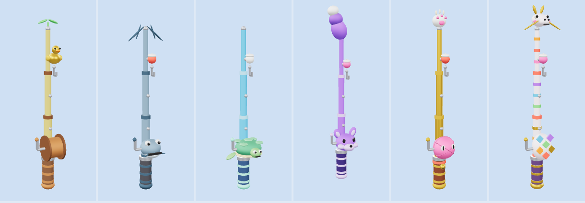
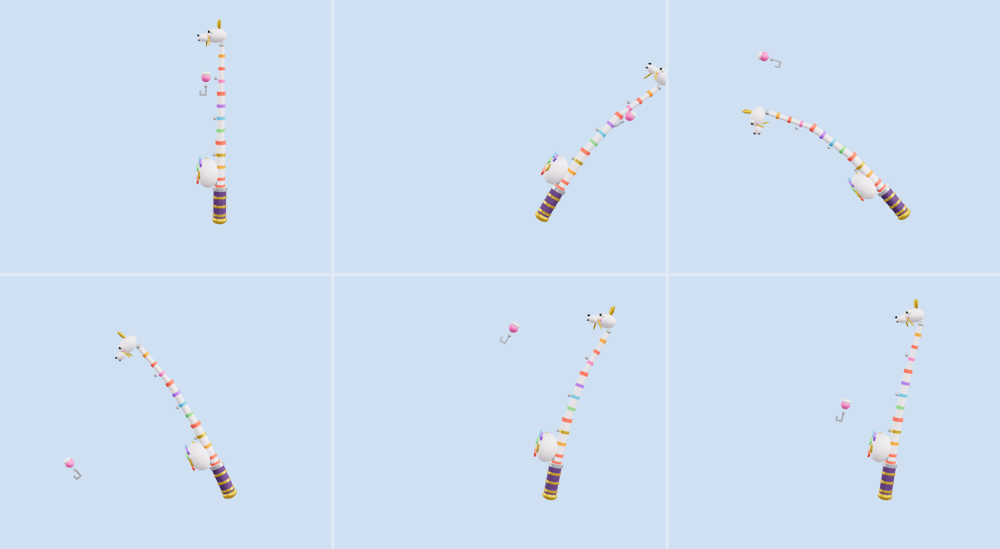

# Cần câu (FishingRod)

Model, animation và hiệu ứng cho 6 cây cần câu trong GDD *Hồ Không Cho Câu*, mỗi bậc độ hiếm một cây (riêng bậc Thường có hai cây). Cần câu là vật phẩm nên theo mục 1.1 của [STYLE_GUIDE.md](../STYLE_GUIDE.md): mỗi cây mang **linh hồn thú vật**, tức là có bộ phận trông và cử động như thú. Cả 6 dùng chung một khung (cán, ống cuộn dây, ba đoạn cần uốn cong, khuyên, móc, phao, rig, animation, script hiệu ứng) và chỉ khác màu cùng phần linh thú.

> Muốn thêm model cùng loại: xem [PRODUCTION.md](PRODUCTION.md) (khung sản xuất).



Ảnh trên: Tre Khởi Đầu, Cá Trê, Rùa Biển, Cáo Tím, Mèo Vàng, Rồng Cầu Vồng. Ảnh dưới là sáu thời điểm của cây Rồng Cầu Vồng (Idle, quăng ở 0,3 / 0,6 / 1,19 giây, kéo cá lên ở 0,5 giây, hụt ở 0,9 giây):



Ảnh render từ GLB, nên không có dây câu (dây là `Beam` do script tạo trong Roblox).

## Danh sách cần câu

| File | Bậc (`Rarity`) | Hình dáng | Linh hồn thú | Cử chỉ |
| --- | --- | --- | --- | --- |
| `Rod_Starter` (Tre Khởi Đầu) | Thường | Cần tre vàng nhạt, ống cuộn bằng gỗ | Phao là **vịt con** bông, đầu có mỏ và mắt | Rụt cổ khi cá cắn, vươn cổ kêu khi bắt được. Có thêm mầm lá nhú ở đầu cần |
| `Rod_Catfish` (Cá Trê) | Thường | Cần xám xanh, ống cuộn là **đầu cá trê** miệng rộng, mắt tròn | Hai **râu cá trê** rủ xuống ở đầu cần, hai râu nhỏ ở miệng cuộn | Râu dựng lên khi căng, vẫy khi vui, rũ xuống khi hụt |
| `Rod_Turtle` (Rùa Biển) | Hiếm | Cần xanh biển, ống cuộn là **mai rùa** có đầu và **chân chèo** | Đầu rùa mắt tròn, miệng cười | Thò đầu ra khi căng, ngẩng lên khi bắt được, **thụt vào mai** khi hụt |
| `Rod_Fox` (Cáo Tím) | Sử thi | Cần tím, ống cuộn là **mặt cáo** có tai, mõm sáng màu, mắt đốm sáng | **Đuôi cáo** xù (chóp trắng) ở đầu cần | Đuôi quẫy theo chuyển động, **nháy mắt** khi bắt được |
| `Rod_Cat` (Mèo Vàng) | Huyền thoại | Cần vàng, ống cuộn là **cuộn len** có mắt mèo, chuông nhỏ buộc ở cán | **Bàn chân mèo** trắng (đệm thịt hồng, móng) ở đầu cần | Chân mèo vẫy mồi như mèo thần tài, chuông leng keng |
| `Rod_Dragon` (Rồng Cầu Vồng) | Thần thoại | Cần ngọc trai có vòng cầu vồng, ống cuộn là **trứng rồng** | **Đầu rồng con** ngậm dây, sừng vàng, má hồng, râu rồng | Đầu gật theo nhịp, ngẩng lên **ợ** khi bắt được, râu bay phấp phới |

Mỗi file gồm `.rbxmx` (đưa vào Studio) và `.glb` (chỉ để xem). Số lượng Part: Starter 41, Catfish 43, Turtle 43, Fox 45, Cat 47, Dragon 59.

## Thiết kế chung

- **Phong cách:** theo [STYLE_GUIDE.md](../STYLE_GUIDE.md), dựng từ Part có sẵn của Roblox (cầu dẹt, trụ, khối). Không cần upload mesh hay texture.
- **Cần đặt riêng để xem:** cần đứng thẳng, mặt trước (hướng quăng, ống cuộn, khuyên dây) là -Z, cao khoảng 6 stud. Nhân vật nào cầm cần nằm ở phía game.
- **Ba đoạn cần** (`Rod1`, `Rod2`, `Rod3`) uốn cong khi quăng và khi kéo, nên cần có độ dẻo thật chứ không cứng đơ.
- **Dây câu** là một `Beam` do `RodEffects` kéo giữa `Tip` (đầu cần) và `LineEnd` (đầu móc), nên tự co giãn khi móc bay ra. Trong file GLB, dây không có.
- **Độ hiếm:** cần càng hiếm thì phần linh thú càng cầu kỳ (từ phao vịt tới đầu rồng con), màu bám bảng màu độ hiếm trong `STYLE_GUIDE.md`.
- **Màu:** mỗi cây một màu chủ đạo (vàng tre, xám xanh, xanh biển, tím, vàng, ngọc trai cầu vồng), nét nhấn nhẹ, ống cuộn và cán tối màu.

### Rig

```
HumanoidRootPart
└─ Grip (cán, ống cuộn, chuông)
   ├─ Rod1 ─ Rod2 ─ Rod3 ─ Hook (móc, phao)
   ├─ Crank (tay quay ống cuộn)
   └─ SpiritA, SpiritB (bộ phận linh thú, gắn vào Rod3, Grip, Hook hay SpiritA tùy cây)
```

Mỗi khớp là một `Motor6D`, tên khớp trùng tên part con. Các part trang trí được hàn bằng `Weld` vào part xương tương ứng. `SpiritA` và `SpiritB` có tên chung ở mọi cây để animation dùng chung: cử chỉ của từng cây (vẫy đuôi, thụt đầu, nháy mắt...) được định nghĩa riêng trong bảng `gestures` của hàm trang trí tương ứng.

## Animation

Game đổi attribute `Anim`. Luồng thường dùng: `Idle` → `Cast` → `Reel` → `Catch` hoặc `Miss` → `Idle`.

| Tên | Lặp | Thời lượng | Mô tả |
| --- | --- | --- | --- |
| `Idle` | có | 2,4 giây/vòng | Đứng chờ, cần lắc nhẹ, móc đung đưa, linh thú động đậy |
| `Cast` | không | 1,2 giây | Ngả cần ra sau lấy đà (0,3 giây), quất về trước và uốn cong (0,6), móc bay ra và rơi xuống nước (0,9), giữ tư thế cuối |
| `Reel` | có | 1,6 giây/vòng | Cần cong căng, tay quay xoay, móc nhích gần rồi nhả, linh thú gồng theo |
| `Catch` | không | 1,6 giây | Gồng (0,3), giật cần (0,5), móc bay lên (0,8), về tư thế nghỉ, linh thú ăn mừng |
| `Miss` | không | 1,4 giây | Gồng, dây chùng (0,6), cần rũ xuống (0,9), lắc đầu, linh thú ỉu xìu |

Thời lượng theo mục 4.5 của `STYLE_GUIDE.md`. `Cast`, `Catch` và `Miss` giữ khung cuối cho tới khi đổi `Anim`. Muốn phát lại cùng một animation không lặp thì phải đổi `Anim` sang tên khác trước. Móc câu lúc nằm trong nước nằm cách đầu cần khoảng 5 stud về phía trước (`WATER` trong `build_rod.py`).

Animation được phát bởi script `RodAnimator`, đó là bản `GooseAnimator` của PoliceGoose dùng lại nguyên văn (ghi `Motor6D.Transform` trực tiếp, không cần upload animation).

## Hiệu ứng (`RodEffects`)

Một script client cho cả 6 cây, theo attribute `Rarity` và `Anim`:

- **Viền sáng** (`Highlight`) theo màu độ hiếm, nhấp nháy khi `Idle` (Thần thoại đổi màu cầu vồng).
- **Dây câu:** `Beam` mảnh màu trắng (Thần thoại: dây cầu vồng).
- **Giọt nước** bắn lên ở móc: khi móc rơi xuống nước lúc `Cast` (0,9 giây), khi giật cá lúc `Catch` (0,5 giây), khi dây chùng lúc `Miss` (0,6 giây).
- **Hạt lấp lánh ở đầu cần:** khi `Idle` và `Reel`, tốc độ theo độ hiếm (0 hạt/giây cho Thường tới 14 hạt/giây cho Thần thoại, `Reel` cộng thêm 2). Khi `Catch` có chớp sáng và một đợt hạt (12 hạt cho Thường, 25 Hiếm, 45 Sử thi, 70 Huyền thoại, 100 Thần thoại).

Chỉ dùng texture hạt có sẵn của Roblox, không cần upload.

## Cài vào Roblox Studio

1. Kéo thả file `.rbxmx` vào cửa sổ Studio, hoặc chuột phải vào `ServerStorage` rồi chọn **Insert from File...**
2. Để thử nhanh, đặt model vào `Workspace` và bấm **Play** (F5). Trong Explorer (góc nhìn client), chọn model rồi đổi attribute `Anim` sang `Idle`, `Cast`, `Reel`, `Catch` hoặc `Miss`.
3. Khi chạy game thật, giữ bản mẫu trong `ServerStorage` và clone ra `Workspace`, đừng để bản mẫu trong `ReplicatedStorage` vì script client sẽ chạy cả trên bản mẫu đó.

## Xem nhanh bằng file GLB

Mỗi `Rod_<Tên>.glb` chứa model và 5 animation (mỗi animation là một clip). Mở bằng https://gltf-viewer.donmccurdy.com, **3D Viewer** của Windows hoặc Blender. File GLB chỉ để xem: không có hiệu ứng và không có dây câu. Muốn dùng trong Roblox thì dùng `.rbxmx`.

## Chỉnh sửa

- Sửa `build_rod.py` rồi chạy `python build_rod.py` để tạo lại cả 6 file `.rbxmx` và `.glb`. Script chỉ dùng thư viện chuẩn của Python, và dùng lại bộ ghi `.rbxmx` của `PoliceGoose` cùng các hàm màu của `Egg`.
  - Khung dùng chung: `frame_parts`, `JOINTS`, bảng `STAGES` (các tư thế của cần theo từng animation).
  - Mỗi cây: bảng `RODS` (màu cần, màu vòng, màu cán, màu phao, hàm trang trí) và các hàm `starter_decor`, `catfish_decor`, `turtle_decor`, `fox_decor`, `cat_decor`, `dragon_decor`. Mỗi hàm trả về các part linh thú, khớp của chúng và bảng `gestures`.
  - Vị trí móc theo từng tư thế được tính tự động (`hook_pose`) từ góc cần, nên sửa góc cần thì móc vẫn ra đúng chỗ.
- Muốn thêm cây mới: viết một hàm trang trí và thêm một dòng vào `RODS`.

## Lưu ý

- Chưa có âm thanh. Làm sau theo [SOUND_GUIDE.md](../SOUND_GUIDE.md).
- Chỉ làm model, animation, phụ kiện và hiệu ứng. Logic câu cá, cần nào mở khóa thế nào nằm ở phía game, không nằm trong repo này.
- Lúc `Catch`, móc chỉ bay lên không mang con mồi. Món câu được (rương, trứng) do phía game gắn vào móc.
- File được sinh bằng script và đã kiểm tra hình dáng, tư thế bằng ảnh render GLB (`preview.png`, `preview_action.png`), nhưng **chưa mở thử trong Roblox Studio**, kể cả script hiệu ứng và dây `Beam`.
