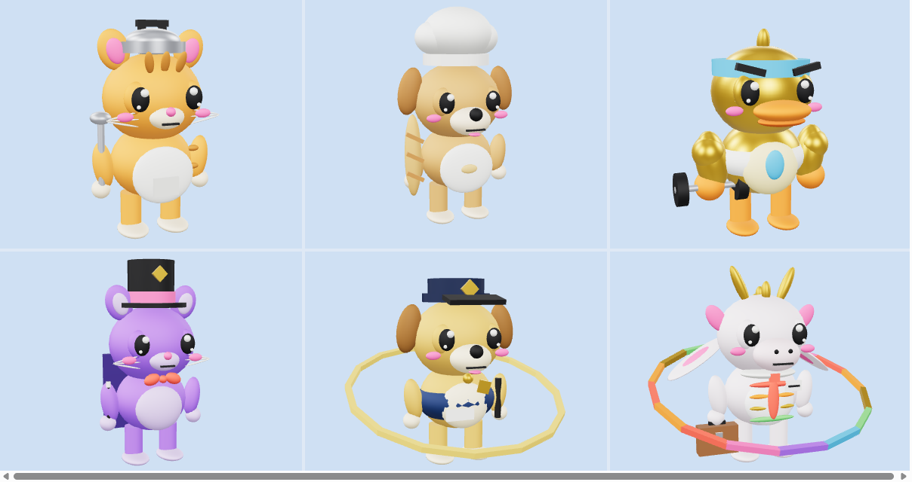
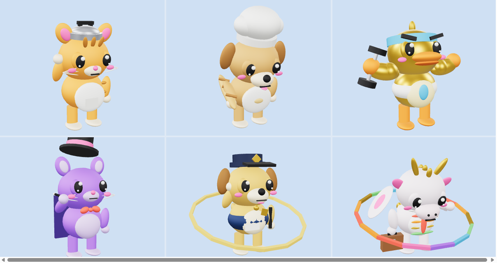

# Pet (Pet)

6 pet nở ra từ 6 loại trứng trong GDD *Hồ Không Cho Câu*: **một trứng nở một pet**. Pet đi theo người chơi và tự chặn, húc ngỗng bảo vệ khi ngỗng tới. Pet là sinh vật nên theo mục 1.1 của [STYLE_GUIDE.md](../STYLE_GUIDE.md): mỗi con có một **ngành nghề** mang tính con người (đầu bếp, thợ làm bánh, huấn luyện viên thể hình, ảo thuật gia, cảnh sát chó, nhân viên văn phòng), nhìn đồ nghề là đoán ra nghề. Cả 6 dùng chung một khung và chỉ khác loài, màu, trang phục và đồ nghề.

> Muốn thêm model cùng loại: xem [PRODUCTION.md](PRODUCTION.md) (khung sản xuất).



Ảnh trên: Mèo Đội Nồi, Chó Bánh Mì, Vịt Cơ Bắp (hàng trên), Mèo Ảo Thuật Gia, Chó K9 Cảnh Sát, Rồng Con Văn Phòng (hàng dưới). Ảnh dưới là khoảnh khắc chính của animation nghề (`Job`) của từng con:



Ảnh render từ GLB, nên không có hiệu ứng, hào quang đứng yên.

## Danh sách pet

| File | Bậc | Nở từ trứng | Loài và nghề | Đồ nghề | Nét hài và animation nghề (`Job`) | Vai trò gợi ý khi chống ngỗng |
| --- | --- | --- | --- | --- | --- | --- |
| `Pet_CatPot` | Thường | Khởi Đầu | Mèo cam, **đầu bếp** | Nắp nồi cơm điện đội đầu (như nắp trên trứng), tạp dề, muỗng canh | Gõ muỗng lên nắp nồi "keng keng" hai lần, nắp nảy xuống | Chống đỡ cơ bản, gõ nồi báo động khi yếu |
| `Pet_DogBaker` | Thường | Lau Sậy | Chó vàng bánh mì, **thợ làm bánh** | Mũ đầu bếp cao, tạp dề, ổ bánh mì dài | Vung bánh mì như kiếm rồi giơ lên khoe | Hỗ trợ rút về, rơi vụn bánh làm ngỗng dừng lại |
| `Pet_DuckMuscle` | Hiếm | Bong Bóng | Vịt vàng, **huấn luyện viên thể hình** | Băng đô xanh, áo ba lỗ, cặp tạ | Gồng hai tay khoe cơ bắp, cặp lông mày cau có | Chịu đòn lâu nhất |
| `Pet_CatMagician` | Sử thi | Tinh Thể | Mèo tím, **ảo thuật gia** | Mũ chóp, nơ đỏ, áo choàng, đũa phép | Vung đũa, mũ chóp bay lên rồi hạ xuống, cúi chào | Làm ngỗng choáng lâu hơn |
| `Pet_DogK9` | Huyền thoại | Vàng Mồi | Chó vàng, **cảnh sát chó** | Mũ kê-pi xanh navy có huy hiệu, áo gile, dùi cui | **Chào kiểu cảnh sát** và vẫy đuôi (hai cảnh sát chào nhau là nét hài với ngỗng) | Làm ngỗng khựng lâu, hào quang vàng xoay |
| `Pet_DragonOffice` | Thần thoại | Rồng | Rồng con ngọc trai, **nhân viên văn phòng** | Cổ áo, cà vạt đỏ, thẻ tên, cặp táp | Nhìn đồng hồ rồi thở dài (hết tiền ăn trưa, khớp GDD), tai và cánh rũ xuống | Phun khói cầu vồng làm ngỗng lạc hướng, hào quang cầu vồng xoay |

Cột "vai trò gợi ý" chỉ để thiết kế animation và hiệu ứng. Số liệu cân bằng (HP, thời gian khựng, hồi HP) là của phía game.

Mỗi file gồm `.rbxmx` (đưa vào Studio) và `.glb` (chỉ để xem). Số lượng Part: CatPot 51, DogBaker 39, DuckMuscle 39, CatMagician 47, DogK9 55, DragonOffice 65 (đều rất nhẹ cho mobile).

## Thiết kế chung

- **Phong cách:** chunky cartoon chibi theo [STYLE_GUIDE.md](../STYLE_GUIDE.md), dựng từ Part có sẵn của Roblox, không upload mesh hay texture. Đứng bằng hai chân để cầm đồ nghề.
- **Kích thước:** cao khoảng 2,8 stud (chưa tính mũ) ở bậc Thường, và **lớn dần theo độ hiếm**: Thường 1,0, Hiếm 1,05, Sử thi 1,1, Huyền thoại 1,15, Thần thoại 1,2. Thấp hơn người chơi để đi theo sau.
- **Mặt:** mắt to có hai đốm sáng kiểu anime, má hồng, **mí mắt** để chớp, nhắm (ngất, hắt xì) và lim dim (khựng). Mèo có râu và tai nhọn, chó có tai cụp và lưỡi, vịt có mỏ cam và lông mày, rồng có sừng vàng, mào và cánh.
- **Màu:** mỗi con một màu chủ đạo lấy từ bảng màu trong `STYLE_GUIDE.md` (cam, vàng bánh mì, vàng, tím, vàng, ngọc trai), thêm màu của đồ nghề.

### Rig

```
HumanoidRootPart (ẩn, có Humanoid R15)
├─ Body ─┬─ Head ─┬─ EarL, EarR     (mèo, chó, rồng; vịt không có)
│        │        ├─ LidL, LidR     (mí mắt)
│        │        ├─ Hat            (mũ nếu có phụ kiện cử động: nồi, mũ đầu bếp, mũ chóp, mũ cảnh sát)
│        │        └─ Headband       (chỉ Vịt)
│        ├─ ArmL ─ ...
│        ├─ ArmR ─ Tool             (đồ nghề cầm ở tay phải: muỗng, bánh mì, tạ, đũa, cặp táp)
│        ├─ Tail
│        └─ WingL, WingR            (chỉ Rồng)
├─ LegL
└─ LegR
```

Mỗi khớp là một `Motor6D`, tên khớp trùng tên part con. Các part trang trí được hàn bằng `Weld` vào part xương tương ứng. `Humanoid` (R15, `HipHeight` theo kích thước, `WalkSpeed` 16) giúp pet đi theo người chơi bằng `Humanoid:MoveTo`. Chỉ part `Body` có `CanCollide`. **Trái là -X, phải là +X** (pet nhìn về -Z).

## Animation

Cả 6 pet dùng chung 8 trạng thái (khác nhau ở động tác nghề `Job`). Game đổi attribute `Anim`. Thời lượng theo mục 4.5 của `STYLE_GUIDE.md`.

| Tên | Lặp | Thời lượng (giây) | Dùng khi |
| --- | --- | --- | --- |
| `Idle` | có | 2,4 | Đứng chờ, thở, chớp mắt |
| `Walk` | có | 1,0 | Đi theo người chơi chậm |
| `Run` | có | 0,6 | Chạy theo, rút chạy |
| `Attack` | có | 0,8 (húc ở 0,45) | Chặn và húc ngỗng |
| `Hurt` | không | 0,7 | Khựng khi bị ngỗng đẩy |
| `Exhausted` | không | 1,6 | Hết HP: ngồi bệt, mắt nhắm. Sau 0,9 giây hiện bong bóng bao lại |
| `Happy` | không | 1,6 (nhảy ở 0,5) | Vừa nở ra từ trứng, hoặc mừng |
| `Job` | không | 2,4 (khoảnh khắc chính ở 0,8) | Động tác nghề riêng của từng con |

Animation không lặp giữ khung cuối. Muốn phát lại cùng một animation không lặp thì đổi `Anim` sang tên khác trước.

## Hiệu ứng (`PetEffects`)

Một script client cho cả 6 pet, theo attribute `Rarity` và `Anim`:

- **Viền sáng** (`Highlight`) theo màu độ hiếm, nhấp nháy khi `Idle` (Thần thoại đổi màu cầu vồng).
- **Hạt lấp lánh** quanh pet khi `Idle`, `Walk`, `Run` (0 hạt/giây cho Thường tới 9 hạt/giây cho Thần thoại).
- **Attack:** sao bắn ra mỗi lần húc (0,45 giây mỗi chu kỳ). **Hurt:** sao khi bị đẩy.
- **Exhausted:** sau 0,9 giây hiện một quả **bong bóng** kính phình ra bao quanh pet, tắt khi đổi `Anim`.
- **Happy:** tim hồng và hạt (8 đến 45 hạt theo độ hiếm) lúc nhảy. **Job:** một đợt hạt ở khoảnh khắc chính.
- **Hào quang xoay** (Chó K9, Rồng): vòng khối Neon nghiêng quanh người, xoay quanh trục đứng.

Chỉ dùng texture hạt có sẵn của Roblox, không cần upload.

## Cài vào Roblox Studio

1. Kéo thả file `.rbxmx` vào cửa sổ Studio, hoặc chuột phải vào `ServerStorage` rồi chọn **Insert from File...**
2. Để thử nhanh, đặt model vào `Workspace` và bấm **Play** (F5). Trong Explorer (góc nhìn client), chọn model rồi đổi attribute `Anim` sang tên một trong 8 trạng thái.
3. Khi chạy game thật, giữ bản mẫu trong `ServerStorage` và clone ra `Workspace` khi trứng nở (đặt `Anim = "Happy"`, rồi `Idle`, `Walk` hoặc `Run` theo việc đang làm). Đừng để bản mẫu trong `ReplicatedStorage` vì script client sẽ chạy cả trên bản mẫu đó.

## Xem nhanh bằng file GLB

Mỗi `Pet_<Tên>.glb` chứa model và 8 animation (mỗi animation là một clip). Mở bằng https://gltf-viewer.donmccurdy.com, **3D Viewer** của Windows hoặc Blender, hoặc `tools/preview.html`. File GLB chỉ để xem: không có hiệu ứng, không có `Humanoid`, vật liệu Neon hiện như màu thường, hào quang đứng yên.

## Chỉnh sửa

Sửa `build_pet.py` rồi chạy `python build_pet.py` để tạo lại cả 6 file `.rbxmx` và `.glb`. Script chỉ dùng thư viện chuẩn của Python, dùng lại bộ ghi `.rbxmx` của `PoliceGoose` và các hàm của `Egg`. Khung chung: `frame_parts`, `FRAME_JOINTS`, bộ animation chuẩn (`animations`). Mỗi pet: hàm `<ten>()` trả về part, khớp riêng và các khung `Job`, cộng một dòng trong bảng `PETS`.

## Lưu ý

- Chưa có âm thanh. Làm sau theo [SOUND_GUIDE.md](../SOUND_GUIDE.md).
- Chỉ làm model, animation, phụ kiện và hiệu ứng. Chuyện pet đi theo người chơi, tìm đường, tự chặn ngỗng, HP, tỉ lệ nở nằm ở phía game, không nằm trong repo này.
- Kế hoạch **tiến hóa** (lớn lên và thêm phụ kiện, tối đa 3 dạng) đã chốt nhưng chưa làm: xem [PLAN_EVOLUTION.md](PLAN_EVOLUTION.md).
- Cánh của Rồng và đuôi chỉ cử động nhẹ trong bộ animation chung. Nếu cần động tác riêng (vỗ cánh, bay) thì thêm khung riêng.
- File được sinh bằng script và đã kiểm tra hình dáng, tư thế bằng ảnh render GLB (`preview.png`, `preview_job.png`), nhưng **chưa mở thử trong Roblox Studio**, kể cả `Humanoid`, script hiệu ứng, bong bóng và hào quang xoay.
