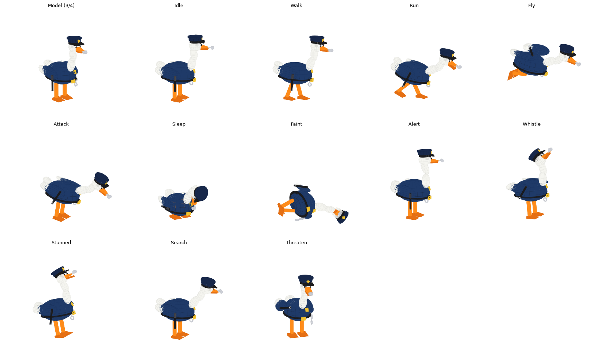

# Ngỗng bảo vệ (PoliceGoose)

Model và animation cho kẻ canh gác đầu tiên trong GDD *Hồ Không Cho Câu*.

> Muốn thêm model cùng loại: xem [PRODUCTION.md](PRODUCTION.md) (khung sản xuất).



## Thiết kế

- **Phong cách:** hoạt hình 3D ít chi tiết, dựng hoàn toàn từ Part có sẵn của Roblox (khối, cầu, trụ, nêm và SpecialMesh dạng cầu). Không cần upload mesh hay texture.
- **Nhận diện từ xa:** cổ trắng dài, thân mặc đồng phục xanh navy, mũ kê-pi có huy hiệu vàng, mỏ cam ngậm còi bạc. Nhìn bóng là biết "ngỗng bảo vệ".
- **Đồ nghề:** dùi cui đen đầu bạc cầm ở mép trước cánh phải, còng tay bạc móc bên hông trái thắt lưng. Còng tay có khớp riêng nên đung đưa khi đi, chạy hoặc khi ngỗng lắc để dọa.
- **Chi tiết hài:** lông mày cau có, thắt lưng có khóa vàng, huy hiệu trên ngực.
- **Kích thước:** cao khoảng 6,7 stud tính cả mũ, cao hơn nhân vật người chơi một chút để trông có uy.

| Màu | Dùng cho |
| --- | --- |
| Navy `#1F3A68` | Thân (áo đồng phục), cánh (tay áo) |
| Trắng `#F5F5F0` | Cổ, đầu, đuôi, đầu cánh |
| Cam `#FF8C1A` | Mỏ, chân |
| Vàng `#F2C230` | Huy hiệu, khóa thắt lưng |
| Đen / bạc | Dùi cui, còng tay, còi |

### Rig

```
HumanoidRootPart
└─ Body
   ├─ NeckLower ─ NeckUpper ─ Head ─┬─ BeakLower
   │                                └─ LidL, LidR   (mí mắt, nhắm khi ngủ hoặc ngất)
   ├─ WingL
   ├─ WingR ─ Baton                         (dùi cui)
   ├─ Tail
   ├─ LegL ─ FootL
   ├─ LegR ─ FootR
   └─ Cuffs                                 (còng tay)
```

Mỗi khớp là một `Motor6D`, tên khớp trùng với tên part con. Các part trang trí như mũ, mắt, còi, huy hiệu và các mắt xích còng tay được hàn bằng `Weld` vào part xương tương ứng. Có `Humanoid` (R15, `HipHeight` 1,6) nên dùng được `Humanoid:MoveTo` và tuần tra bằng `PathfindingService`.

## Animation

| Tên | Lặp | Dùng khi (theo GDD) |
| --- | --- | --- |
| `Idle` | có | Đứng gác, ngó quanh |
| `Walk` | có | Đi chậm khi tuần tra theo mốc |
| `Run` | có | Đuổi người chơi |
| `Fly` | có | Bay vỗ cánh (chỉ là hình ảnh, xem phần lưu ý) |
| `Attack` | có | Mổ hoặc cắn pet đang chặn |
| `Sleep` | có | Ngủ gật khi trực (bảo vệ ngủ gật hoặc đổi ca) |
| `Faint` | không | Ngất xỉu rồi nằm im, giữ tư thế cuối |
| `Alert` | không | Dựng cổ khi nghi ngờ, giữ tư thế cuối |
| `Whistle` | không | Thổi còi trước khi đuổi |
| `Stunned` | không | Khựng lại khi trúng đòn của pet |
| `Search` | có | Cúi tìm ở vị trí mất dấu cuối cùng |
| `Threaten` | không | Đứng ở ranh giới nơi an toàn, chĩa dùi cui gõ dọa rồi lắc còng tay |

## Âm thanh

Thư mục [Sounds/](Sounds/) có 12 file `.wav` (một file cho mỗi animation) do `Sounds/build_sounds.py` tự tổng hợp bằng code, dùng lại hàm tổng hợp của `TreasureChest/Sounds`. Script client `GooseSounds` phát âm thanh theo attribute `Anim`:

| Animation | Âm thanh | Cách phát |
| --- | --- | --- |
| `Idle` | Hai tiếng "quác" nhỏ | Lặp mỗi 6 giây |
| `Walk`, `Run` | Tiếng chân vịt chạm đất | Lặp mỗi 0,5 giây (đi) và 0,22 giây (chạy) |
| `Fly` | Tiếng vỗ cánh | Lặp mỗi 0,5 giây |
| `Attack` | Quác gắt rồi tiếng mổ "cộp" | Lặp mỗi 0,7 giây, tiếng mổ khớp lúc 0,42 giây |
| `Sleep` | Tiếng ngáy | Lặp mỗi 3 giây |
| `Search` | Tiếng khịt mũi đánh hơi | Lặp mỗi 2,4 giây |
| `Faint` | Quác chao đảo, tiếng ngã "phịch", chân giật nhẹ | Một lần |
| `Alert` | Tiếng quác giật mình | Một lần |
| `Whistle` | Hai hồi còi | Một lần, khớp hai lần ngẩng đầu |
| `Stunned` | Tiếng "bốp", quác méo tiếng và chuông quay cuồng | Một lần |
| `Threaten` | Gầm gừ, hai tiếng gõ dùi cui, lắc còng tay leng keng | Một lần |

Âm thanh theo [SOUND_GUIDE.md](../SOUND_GUIDE.md): peak file 0,5, `volume` tối đa 0,8, tông còi không rít, không trầm dưới 100 Hz.

Roblox không cho nhúng âm thanh vào model, nên phải upload:

1. Upload từng file lên Creator Hub (Audio) bằng tài khoản của anh. Nếu không nhận `.wav` thì đổi sang `.mp3` hoặc `.ogg`.
2. Điền `rbxassetid://<id>` vào bảng `SOUNDS` ở đầu `GooseSounds.client.luau`, sửa `volume` hoặc `period` nếu muốn. Có thể sửa trong Studio rồi chép lại vào file, hoặc sửa file rồi chạy lại `python build_police_goose.py`.

Id để trống thì animation đó im lặng, nên model vẫn chạy bình thường khi chưa upload. Sau khi đổi `Anim`, âm thanh của animation cũ dừng phát lần kế tiếp ngay (tiếng đang phát dở sẽ tự kết thúc).

## Cài vào Roblox Studio

1. Kéo thả `PoliceGoose.rbxmx` vào cửa sổ Studio, hoặc chuột phải vào `ServerStorage` rồi chọn **Insert from File...**
2. Để thử nhanh, đặt model vào `Workspace` và bấm **Play** (F5). Trong Explorer (đang ở góc nhìn client), chọn `PoliceGoose` rồi đổi attribute `Anim` trong Properties sang tên animation muốn xem.
3. Khi chạy game thật, giữ bản mẫu trong `ServerStorage` và clone ra `Workspace`. Đừng để bản mẫu trong `ReplicatedStorage`, vì script client sẽ chạy cả trên bản mẫu đó.

## Đổi animation từ server

Animation được phát trên client bởi script `GooseAnimator` (`RunContext = Client`). Server chỉ cần đổi attribute `Anim` trên model:

```lua
local goose = ServerStorage.PoliceGoose:Clone()
goose.Parent = workspace
goose.HumanoidRootPart:SetNetworkOwner(nil)

goose:SetAttribute("Anim", "Walk")
goose.Humanoid.WalkSpeed = 10
goose.Humanoid:MoveTo(patrolPoint)

-- Phát hiện người chơi
goose:SetAttribute("Anim", "Alert")
task.wait(1.4)
goose:SetAttribute("Anim", "Whistle")
task.wait(1)
goose:SetAttribute("Anim", "Run")
goose.Humanoid.WalkSpeed = 18
```

- Animation không lặp sẽ giữ khung cuối cho tới khi server đổi `Anim` sang tên khác. Muốn phát lại cùng một animation không lặp (ví dụ `Stunned` hai lần liên tiếp) thì phải đổi `Anim` sang tên khác trước, rồi mới đặt lại tên cũ.
- Khi đổi animation, script tự chuyển mượt trong 0,15 giây.
- Tên animation sai sẽ báo lỗi `PoliceGoose: unknown animation ...` trong Output.

## Xem nhanh bằng file GLB

`PoliceGoose.glb` chứa cùng model và 12 animation (mỗi animation là một clip, đặt tên giống bảng trên). Mở bằng:

- Trình duyệt: kéo file vào https://gltf-viewer.donmccurdy.com và chọn clip trong mục Animation.
- Windows: ứng dụng **3D Viewer**.
- Blender: **File > Import > glTF 2.0**, chọn clip trong Action Editor hoặc NLA.

File GLB chỉ dùng để xem. Muốn đưa vào Roblox thì dùng `PoliceGoose.rbxmx`.

## Chỉnh sửa

- **Chỉnh dáng hoặc animation bằng code:** sửa `build_police_goose.py` (bảng `PARTS`, `JOINTS`, `ANIMATIONS`), chạy `python build_police_goose.py` để tạo lại file `.rbxmx`. Script chỉ dùng thư viện chuẩn của Python.
- **Xuất lại GLB:** chạy `python export_glb.py` (chỉ dùng thư viện chuẩn).
- **Chỉnh animation trong Studio:** các `KeyframeSequence` nằm trong thư mục `Animations` của model. Sửa trực tiếp `Pose.CFrame` hoặc thay bằng bản mới là script tự đọc lại, không cần upload.
- **Muốn dùng `Animator` chuẩn của Roblox:** publish từng `KeyframeSequence` để lấy Animation ID (chuột phải, chọn **Save to Roblox**, hoặc dùng Animation Editor), rồi `LoadAnimation` như rig thường. Khi đó bỏ script `GooseAnimator` đi để hai cơ chế không cùng ghi vào `Motor6D.Transform`.

## Lưu ý

- `Fly` chỉ nâng thân và vỗ cánh. Ngỗng không tự bay lên: `Humanoid` vẫn giữ nó trên mặt đất. Nếu cần bay thật, phải tự di chuyển `HumanoidRootPart` (ví dụ bằng `AlignPosition`).
- Chỉ part `Body` có `CanCollide`. Đầu, cổ và chân xuyên qua vật cản để animation mổ hay ngất không bị vật lý đẩy lệch.
- File `.wav` chỉ được kiểm tra về độ dài, biên độ (không bị vỡ tiếng) và độ lệch DC, **chưa nghe thử**. Âm tổng hợp bằng code chỉ ở mức hiệu ứng đơn giản, nếu cần chất lượng cao hơn thì thay bằng âm thanh thu sẵn rồi điền id vào `GooseSounds`.
- File được sinh bằng script và đã kiểm tra hình dáng, tư thế bằng ảnh render offline (`preview.png`), nhưng **chưa mở thử trong Roblox Studio**, kể cả script âm thanh.
