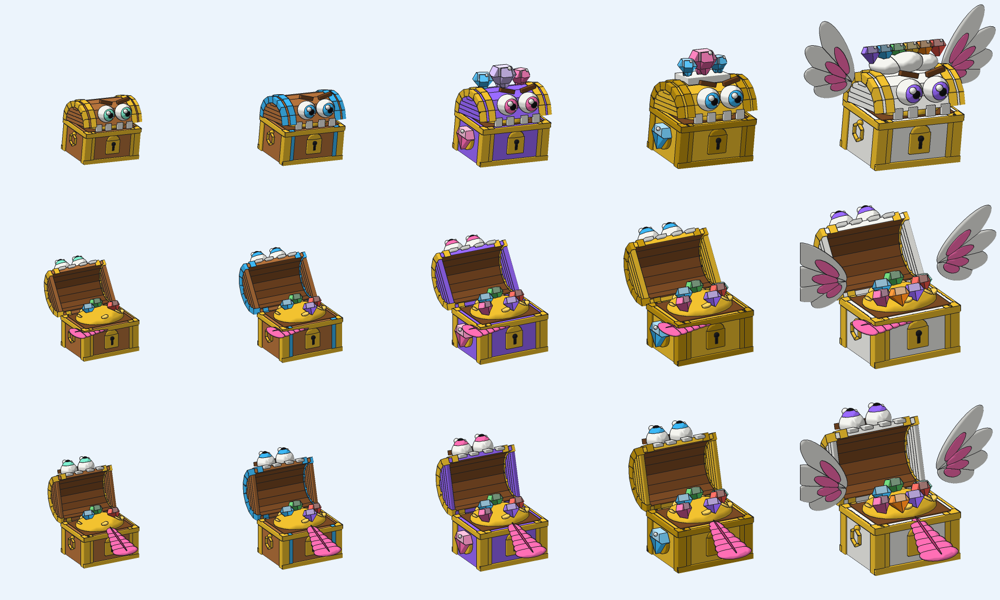

# Rương kho báu (TreasureChest)

Rương xuất hiện khi người chơi câu trúng. Có 5 bậc độ hiếm, mỗi bậc là một model riêng (khác hình dáng, màu và hiệu ứng) để cho ra phần thưởng riêng. Làm theo [STYLE_GUIDE.md](../STYLE_GUIDE.md).

> Muốn thêm model cùng loại: xem [PRODUCTION.md](PRODUCTION.md) (khung sản xuất).



Hàng trên: đứng chờ. Hàng giữa và dưới: đang mở và mở xong. Từ trái sang phải: Thường, Hiếm, Sử thi, Huyền thoại, Thần thoại.

## Thiết kế

- **Phong cách:** chunky cartoon, dựng từ Part có sẵn của Roblox (khối, cầu, trụ), không cần upload mesh hay texture. Hình dáng theo ảnh tham chiếu: nắp vòm ghép từ các tấm phẳng, khung vàng (trụ góc, viền trên và dưới, đai trên nắp), ổ khóa vàng lớn, tay cầm vòng hoặc đĩa gắn ngọc ở hai bên, bên trong là đống vàng và đá quý.
- **Rương là sinh vật sống:** mắt to lồi ra khỏi nắp, có đốm sáng kiểu anime, lông mày cau có dễ thương. Khe nắp là miệng, có răng, và thè lưỡi khi mở: lưỡi là một dải thẳng, nhỏ ở gốc và to dần ra ngoài, có rãnh ở giữa.
- **Đá quý** là kim cương nhiều mặt: phần trên gồm mặt bàn và hai mặt vát, phần dưới thu nhọn về một điểm, mỗi mặt một sắc độ. Đá ở đầu rương (Sử thi, Huyền thoại) ghép hai tấm vuông góc để mặt nào cũng thấy cạnh, có thêm đốm lấp lánh.
- **Phân biệt độ hiếm:** càng hiếm càng to, nhiều đá quý và chi tiết, nhìn bóng cũng nhận ra.

| Bậc | Cao (stud) | Màu | Chi tiết riêng | Hiệu ứng (script) |
| --- | --- | --- | --- | --- |
| Thường (`Common`) | 2,6 | Gỗ, đai vàng | Tay cầm vòng, 3 kim cương | Viền trắng, ít hạt |
| Hiếm (`Rare`) | 2,8 | Gỗ, đai xanh | Đai xanh trên nắp và thân, 4 kim cương | Viền xanh, hạt lấp lánh |
| Sử thi (`Epic`) | 3,2 | Tím, đai vàng | 3 kim cương lớn trên nắp, đĩa vàng gắn kim cương hồng, 5 kim cương trong rương | Viền tím, nhiều hạt |
| Huyền thoại (`Legendary`) | 3,6 | Vàng, đai vàng đậm | Vòng vương miện trắng gắn 3 kim cương, đĩa vàng gắn kim cương xanh, 6 kim cương trong rương | Viền vàng, nhiều hạt, tia sáng khi mở |
| Thần thoại (`Mythic`) | 4,0 | Trắng, đai vàng | Mây trắng và 6 kim cương cầu vồng trên nắp, đôi cánh 4 lớp lông trắng lót hồng, 7 kim cương trong rương | Viền đổi màu cầu vồng, hạt cầu vồng, tia sáng khi mở |

### Rig

```
HumanoidRootPart (neo cố định, ẩn)
└─ Base ─┬─ Lid        (nắp vòm, bản lề ở phía sau; mắt, răng, đai, vương miện... đi theo nắp)
         ├─ Tongue     (lưỡi, nằm phẳng trong thân khi đóng; xoay 180 độ quanh gốc để thè ra, rủ nhẹ và lắc sang hai bên)
         ├─ WingL      (chỉ Thần thoại)
         └─ WingR      (chỉ Thần thoại)
```

Mỗi bậc có khoảng 135-210 part (Thần thoại nhiều nhất vì có cánh và nhiều đá quý). Mỗi khớp là một `Motor6D`. Các part trang trí được hàn bằng `Weld` vào part xương tương ứng. Không có `Humanoid`, nên server tự đặt vị trí rương bằng `PivotTo` hoặc tween.

## Animation

Cả 5 bậc dùng chung bộ animation (bậc nào không có cánh thì bỏ qua phần cánh).

| Tên | Lặp | Dùng khi |
| --- | --- | --- |
| `Spawn` | không | Rương nổi lên từ nước, nảy lên rồi đáp xuống |
| `Idle` | có | Rung báo hiệu, nắp hé nhẹ. Cũng là trạng thái mặc định |
| `Open` | không | Nén xuống, bật nắp, thè lưỡi lắc, giữ tư thế mở |
| `Vanish` | không | Đóng nắp, nhảy lên rồi xoay và chìm xuống nước |

Animation không lặp giữ khung cuối cho tới khi server đổi `Anim` sang tên khác.

## Hiệu ứng

`ChestEffects` đọc attribute `Rarity` và `Anim` của model, tự tạo:

- Viền `Highlight` theo màu độ hiếm, nhấp nháy khi `Idle` (Thần thoại đổi màu cầu vồng).
- Hạt lấp lánh khi chờ (từ Hiếm trở lên), bắn hạt và chớp sáng khi `Open`, tia sáng dọc từ Huyền thoại trở lên.
- Bọt nước khi `Spawn`, mờ dần và bắn hạt khi `Vanish`.

Chỉ dùng texture hạt có sẵn của Roblox, không cần upload.

## Âm thanh

Thư mục [Sounds/](Sounds/) có 9 file `.wav` do `Sounds/build_sounds.py` tự tổng hợp bằng code (âm đơn giản kiểu cartoon). Script `ChestSounds` phát âm thanh theo `Anim`:

| Action | File | Ghi chú |
| --- | --- | --- |
| `Spawn` | `chest_spawn.wav` | Tiếng nước bõm, nảy và đáp xuống |
| `Idle` | `chest_idle.wav` | Tiếng nắp lạch cạch, lặp theo chu kỳ rung (1,4 giây) |
| `Open` | `chest_open.wav` | Tiếng cọt kẹt, bụp khi bật nắp (đúng giây 0,42), tiếng lò xo khi lưỡi lắc |
| `Open` | `chest_chime_<bậc>.wav` | Chuông ngân phát cùng lúc bật nắp. Bậc càng hiếm càng nhiều nốt (1 nốt cho Thường, 6 nốt cho Thần thoại) |
| `Vanish` | `chest_vanish.wav` | Đập nắp, chuông tan dần, chìm xuống nước |

Âm thanh theo [SOUND_GUIDE.md](../SOUND_GUIDE.md): peak file 0,5, chuông nằm dưới khoảng 3 kHz, `volume` theo độ hiếm từ 0,5 (Thường) đến 0,8 (Thần thoại).

Roblox không cho nhúng âm thanh vào model, nên phải upload:

1. Upload từng file lên Creator Hub (Audio) bằng tài khoản của anh. Nếu không nhận `.wav` thì đổi sang `.mp3` hoặc `.ogg`.
2. Điền `rbxassetid://<id>` vào bảng `IDS` ở đầu `ChestSounds.client.luau`.
3. Chạy lại `python build_treasure_chest.py` để nhúng script vào các file `.rbxmx`.

Id để trống thì bị bỏ qua, nên rương vẫn chạy bình thường (chỉ không có tiếng) cho tới khi điền.

## Cài vào Roblox Studio

1. Kéo thả các file `TreasureChest_<Bậc>.rbxmx` vào cửa sổ Studio, hoặc chuột phải vào `ServerStorage` rồi chọn **Insert from File...**
2. Giữ bản mẫu trong `ServerStorage` và clone ra `Workspace` khi cần. Đừng để bản mẫu trong `ReplicatedStorage`, vì script client sẽ chạy cả trên bản mẫu đó.
3. Để thử nhanh, đặt model vào `Workspace`, bấm **Play** rồi đổi attribute `Anim` trong Properties.

## Dùng từ server

```lua
local chest = ServerStorage.TreasureChest_Rare:Clone()
chest:PivotTo(CFrame.new(spawnPosition))
chest.Parent = workspace

chest:SetAttribute("Anim", "Spawn")
task.wait(1.2)
chest:SetAttribute("Anim", "Idle")

-- Khi người chơi bấm mở
chest:SetAttribute("Anim", "Open")
task.wait(1.4)
giveReward(player, chest:GetAttribute("Rarity"))

chest:SetAttribute("Anim", "Vanish")
task.wait(1.2)
chest:Destroy()
```

- Chọn model theo độ hiếm bằng tên: `ServerStorage["TreasureChest_" .. rarity]`.
- Muốn phát lại cùng một animation không lặp thì đổi `Anim` sang tên khác trước.
- Script `ChestAnimator` là bản sao của `PoliceGoose/GooseAnimator.client.luau` (file được script build đọc trực tiếp từ thư mục đó).

## Xem nhanh bằng file GLB

Mỗi bậc có một file `.glb` chứa model và 4 animation. Mở bằng https://gltf-viewer.donmccurdy.com, **3D Viewer** của Windows hoặc Blender. File GLB chỉ dùng để xem, muốn đưa vào Roblox thì dùng `.rbxmx`.

## Chỉnh sửa

Sửa `build_treasure_chest.py` (bảng `TIERS`, hàm `chest_data`, bảng `ANIMATIONS`) rồi chạy `python build_treasure_chest.py` để tạo lại cả `.rbxmx` lẫn `.glb`. Script chỉ dùng thư viện chuẩn của Python và dùng chung code ghi file với `PoliceGoose/`.

## Lưu ý

- Khi nắp mở, mắt nằm trên mặt trước của nắp nên quay lên trời, chỉ còn thấy ló ở mép nắp. Đây là đánh đổi của kiểu mặt-trên-nắp.
- Part của Roblox không có vân gỗ, đinh tán hay bóng vẽ tay như ảnh tham chiếu. Nắp vòm là đa giác 8 cạnh, vân gỗ chỉ là các đường nối giữa tấm phẳng, kim cương ghép từ khối và nêm (WedgePart), chưa có mặt cắt tròn như đá thật. Muốn mịn hơn thì phải dựng mesh trong Blender rồi upload.
- Roblox không đổi kích thước part bằng animation, nên `Vanish` là chìm và xoay chứ không thu nhỏ.
- File `.wav` chỉ được kiểm tra về độ dài, biên độ (không bị vỡ tiếng) và độ lệch DC, **chưa nghe thử**. Âm tổng hợp bằng code chỉ ở mức hiệu ứng đơn giản, nếu cần chất lượng cao hơn thì thay bằng âm thanh thu sẵn rồi điền id vào `ChestSounds`.
- File được sinh bằng script và đã kiểm tra hình dáng, tư thế bằng ảnh render offline (`preview.png`), nhưng **chưa mở thử trong Roblox Studio**, kể cả script hiệu ứng và âm thanh.
